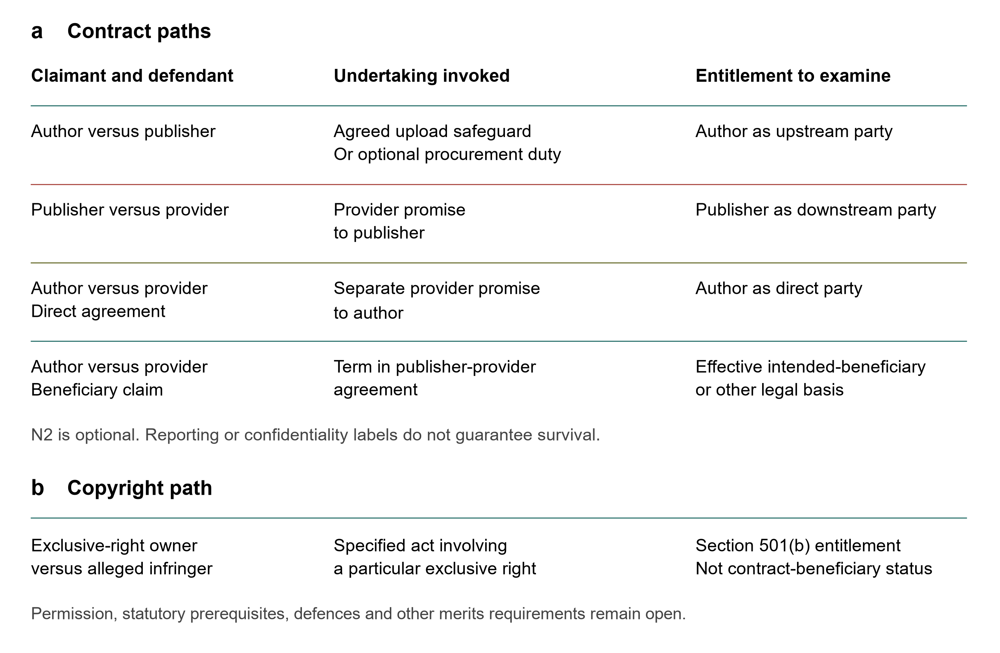

# Internal AI Processing and Independent Reuse of Trade Books: Contract triggers and author remedies in U.S. publishing

Anhui Zhang; Shuliang Hong

Shandong University of Finance and Economics (SDUFE), Jinan, China; Yunnan University, Kunming, China.

Equal first authorship. Author preprint v0.12, 13 October 2026; not peer reviewed or a version of record.

Copyright (c) 2026 Anhui Zhang and Shuliang Hong. CC BY-NC-ND 4.0; third-party material excluded from this grant.

## Abstract

Permission to perform an internal AI-assisted publishing task does not necessarily settle the safeguards attached to the chosen processing channel. This article examines public Authors Guild book-contract models through a purposive doctrinal comparison centred on New York contract law and Second Circuit copyright decisions. Its preferred reading gives effect to channel permission supplied elsewhere in the agreement while retaining the training safeguard attached to an allowed consumer-facing upload. A worked dispute identifies the consequence: fresh approval may be redundant, but safeguard performance remains a separate question. A hypothetical baseline and three variations distinguish task-only assistance, a consumer-facing channel, asserted independent provider training and sufficient direct author permission. The analysis then separates the publisher's undertaking, an accepted provider promise and the author's enforcement basis. Copyright preemption requires examination of the interest asserted, not merely an added fact or a new duty label. A limited coordination amendment, N1, illustrates the principal response. Vendor procurement and direct-provider terms are subsidiary options requiring a justified need, defined obligations and actual assent. The public models do not establish adoption, breach or a guaranteed remedy. The contribution is a reasoned clause application that changes which obligation is examined, not discovery of the clauses or a new training entitlement.

Keywords: Copyright licensing; Trade-book publishing; Generative AI; Contract interpretation; Third-party beneficiaries; Copyright preemption

## 1 Introduction

A publisher can be authorized to use a manuscript for an AI-assisted task without holding authority for the provider's independent reuse. Conversely, paying an outside service does not necessarily create a sublicense. The difficult arrangement combines a publishing task with a channel or provider term that raises a separate training question. Treating the entire arrangement as internal, or every provider as an independent licensee, obscures which act and obligation are disputed. The analysis must distinguish the publisher's task permission, safeguards attached to the chosen channel and the authority asserted for any additional use.

Consider a publisher obtaining help with marketing metadata from an outside AI service. The publisher's purpose is connected to publication, but the means of performing it may involve a consumer-facing system or a service whose terms assert additional training uses. A permission for the publisher's task, a condition on the upload and an undertaking to transmit obligations to sublicensees may consequently require different facts. The presence of the author at the beginning of this arrangement does not identify the party bound by every subsequent promise. This is a constructed problem for legal analysis, not an account of an observed transaction.

The central argument concerns a safeguard that can remain after the upload permission question is answered. Where the complete agreement already allows the specified consumer-facing workflow, fresh approval need not be demanded again. Unless the adopted terms provide otherwise, that permission does not remove the accompanying training safeguard. The proposed reading therefore separates a redundant approval objection from a dispute about the publisher's performance. It identifies the obligation to examine; it does not establish infringement, an enforceable contract claim or relief.

The contribution is a critical application of particular book-contract models. Bernoff already reproduces and recommends the Authors Guild clauses, including internal operations and uploads. Henderson and Lemley analyse preemption, training data and downstream contract reach; Rajbhandari develops implied-sublicensing relationships. Those distinctions are not new here. The narrower contribution is a reasoned coordination of overlapping permissions and safeguards, tested by a dispute in which the competing readings change the obligation under examination. The article develops that application rather than claiming originality from a new diagram or from changing the object of familiar doctrine to book inputs. [1, 2, 3]

Public models permit examination of contractual events even when adoption is unknown. They do not establish the permissions or performance of any actual publisher or provider. The value of the comparison must therefore lie in its resolution of a defined interpretive dispute, not in a claim about industry-wide contracting defects or the number of unresolved permissions.

The principal scope is protected trade-book material supplied for a publisher-directed task under U.S. law. New York contract law and Second Circuit decisions anchor the focused interpretation and enforcement comparison. Cross-circuit licence decisions are used as contrasts, not assembled into a uniform national rule. The analysis separates permissions from statutory defences and does not decide fair use for AI training in general. It likewise makes no finding about technical model behaviour, industry contracting rates or transaction costs. Its proposed amendments change specified contractual obligations; they are not provisions of current law.

Section 2 identifies the materials and analytical premises. Section 3 supplies the permission and actor distinctions needed for the contract problem. Section 4 compares the clause readings, applies the preferred reconciliation and tests the baseline and three hypothetical variations. Section 5 connects the resulting undertaking to claimants, preemption, limited drafting responses and relief. Section 6 addresses overlap, adequate-contract counterexamples and implementation burdens. The conclusion returns to the principal result: resolving upload approval need not resolve safeguard performance.

## 2 Scope materials and method

The method is purposive doctrinal comparison and critical clause application, not a systematic review or measurement of contracting practice. New York and Second Circuit materials anchor interpretation, assistance, assent, beneficiary entitlement, preemption and preliminary relief; other jurisdictions provide bounded contrasts. The Rosetta judicial excerpts and Authors Guild models identify contractual wording. Judicial holdings supply legal propositions with procedural and jurisdictional limits. Altai, Briarpatch and Jackson distinguish substantive interests from facts that merely alter a claim's scope. The comparison applies these distinctions to the constructed arrangement rather than estimating their frequency in publishing. [4, 5, 6, 7, 8, 9, 10, 11, 12, 13]

The historical material consists of judicial excerpts from five publishing agreements in one dispute, not five inspected original instruments. The supplementary source matrix retains eleven clause rows from five documents in two institutional clusters; these are not independent transactions. Public models and adjacent standard terms are not executed AI agreements. Rosetta's preliminary-injunction posture, Oracle's separate costs reversal, ML Genius's nonprecedential status and Walton's revisable slip-opinion form constrain the uses made of them below. [4, 14, 15, 16, 17, 18, 19]

Section 4 combines selected provisions in a hypothetical agreement. A0 assumes authorized task-only assistance; A1 changes the channel; A2 adds asserted independent training; A3 adds sufficient direct permission from an author retaining relevant authority. The worked A1 dispute adds explicit assumptions about channel agreement and missing safeguards. Section 5 compares three proposed obligation formulations. These constructions identify conditional consequences, not observed contracts, coding units or predicted judgments. Earlier permission and claimant contrasts remain supplementary records, not another empirical sample.

The source record distinguishes passages reread through 13 October 2026 from inherited readings and limited-access materials. Located support and selected version checks are not comprehensive docket or commercial citator clearance. Model language, accompanying advice and proposed amendments have separate roles. This article examines particular asserted interests under section 301, not complete immunity from conflict preemption, copyright misuse or public-policy objections. A manuscript's unpublished status does not itself establish a trade secret or a confidential or fiduciary relationship. [2, 11, 12, 13]

Generative-AI assistance was used in organizing public-source materials, developing structural and critical comparisons, drafting and revising text, assisting source checks, and generating Python code for reproducible conceptual figures. OpenAI Codex was used in the recorded current workflow; exact model identifiers and settings were not consistently retained across earlier rounds. AI-generated suggestions are not authorities or independent validation. The authors take responsibility for the selection and interpretation of sources and for the final argument. The figures are code-rendered illustrations of specified legal premises, not generated empirical observations. No independent second-coder or intercoder-reliability result is claimed.

## 3 Permission and provider conduct

### 3.1 The protected material and the granted activity

U.S. copyright law permits exclusive rights, and subdivisions of those rights, to be owned separately. Ownership of a copy is distinct from copyright ownership. A publisher's name or an ISBN cannot, by itself, establish authority to license every act involving the book. Nor does copyright in an edition's original compilation or additions enlarge ownership of pre-existing material under section 103(b). The object of the inquiry is therefore the relevant protected material and specified act, not an undifferentiated right to use a book. This does not imply that every component invariably needs separate consent: ownership, existing permission, public-domain status and applicable limitations must be examined first. [20, 21]

The first contractual question is what exploitation was granted, rather than whether the technology existed when the agreement was made. A publishing grant, a reproduction permission, a distribution right and authority to permit another person's copying are not interchangeable descriptions. An all-formats clause may broaden the means of performing the granted activity without erasing its purpose or other limits. Conversely, a genuinely broad grant may already encompass the intended act without a fresh AI-specific agreement. The inquiry cannot begin with a presumption either that all digital copying is licensed or that all training necessarily constitutes a reserved contractual category.

The Second Circuit's new-use cases prevent an automatic reservation rule. Bartsch found the particular motion-picture assignment broad enough for television exhibition and examined the upstream assignment as well. Boosey & Hawkes found video distribution within the basic film grant, while leaving another contractual provision for further proceedings. The latter opinion disclaimed a default favouring licensees and distinguished exploiting the licensed film from exploiting the composition outside it. Medium breadth can therefore answer one scope question without resolving every restriction or downstream grant. Neither decision allocates a book's AI-training uses. [22, 23]

The Ninth Circuit's contrary result in Cohen depended on its synchronization licence, specified exhibition permissions and reserved rights, not simply the lack of a future-technology phrase. Rosetta provides a book-specific comparison, but the Second Circuit reserved the ultimate electronic-book scope merits while affirming denial of preliminary relief. The grants and procedural settings cannot be flattened into a national purpose test. For the present arrangement, these opinions justify examining whether the asserted copying implements a licensed publishing activity or an additional exploitation; they do not require a fresh agreement merely because AI is involved. [24, 23, 14]

Rosetta's district opinion also shows why a grant and a separate restraint must not be merged. Its excerpts include future-copying language and differently framed noncompetition obligations. The court distinguished the authors' possible breach of a promise from the copyright claim asserted against Rosetta and did not decide that breach. An upstream restriction can consequently raise a question about the author's or publisher's obligation without determining the rights of a different downstream actor. Historical phrases remain relevant to the interpretive inquiry, but their appearance in five agreements neither proves current practice nor supplies the full instruments. [4]

### 3.2 Assistance and a separately asserted use

The second question concerns the relation between the authorized person and the actor performing the copying. An owner, an exclusive-right holder, a nonexclusive licensee, an authorized sublicensor and an agent assert different bases. A party's ability to perform an act does not itself show unrestricted power to authorize independent downstream exploitation. Equally, a new actor's involvement does not invariably require a separate sublicense. The relevant records must make it possible to distinguish performance on behalf of the licensee from a separate use for which that actor claims authority. The legal consequence depends on the governing instrument, law and facts, rather than on calling every service provider a sublicensee.

The Second Circuit's Great Minds v. FedEx makes this limiting proposition particularly concrete. Under the nonexclusive public licence before it, schools could use a paid reproduction agent to perform their permitted uses; the contractor did not automatically become an independent licensee. The court distinguished licence authorization from the fair-use cases invoked by Great Minds, and affirmed dismissal. The Ninth Circuit's Office Depot decision supplies a related contrast. These holdings do not establish an AI-training defence or automatically determine assistance under an exclusive book-publishing grant. They instead defeat the premise that a contractor's fee alone requires independent permission. [10, 25]

Oracle v. Rimini Street illustrates the other side of the distinction. For the J.D. Edwards and Siebel licences, the court recognized permitted customer-support outsourcing but rejected copying under one customer's licence to support other or future customers. The licence-specific limit concerned whose use the work supported; it was not a ban on all third-party services. The PeopleSoft analysis involved a different local-hosting restriction and did not decide its cross-use question. The Supreme Court subsequently reversed the costs ruling, followed by a costs remand; that subsequent treatment must accompany reliance on the earlier opinion. This article uses the specified outsourcing analysis, not the reversed costs proposition or an assumed ruling on AI. [15, 16, 17]

Universal Instruments supplies a focused New York-law example of authorized external assistance: its particular grant expressly included suppliers and subcontractors using software for the customer's benefit. The court did not equate internal use with work solely on the customer's premises. It separately addressed modification under section 117 and a preempted contract theory. For book inputs, the interpretation of that specific grant is the useful contrast; the computer-program defence is not transferred to literary training. An actor's external location, fee or corporate identity cannot replace the terms identifying the permitted use and its beneficiary. [26]

Authority also need not always take the form of a separately signed downstream licence. Orgill upheld an implied sublicense where a detailed upstream nonexclusive grant permitted unrestricted sublicensing and the conduct demonstrated the permission at issue. It did not make silence universally sufficient or decide that a retroactive grant cures every infringement. Rajbhandari's commentary already addresses implied-sublicensing relationships. The practical inquiry is therefore into power and actual permission, including legally sufficient conduct, rather than a mandatory document format. A provider's standard term and an upstream right to sublicense are relevant facts, but neither alone proves an effective grant for the disputed use. [27, 21, 3]

In the publishing arrangement, a provider may perform the instructed metadata task, retain material for a defined operational reason, or assert an additional use for its independently offered model. These possibilities should not be merged into one technical event. Retention does not by itself establish training or infringement, and deletion does not retrospectively establish permission. Nor does the author's retention of some rights settle the publisher's permitted assistance. The record must identify the act in dispute and what authority is asserted for it. Where sufficient applicable permission is established, that question should close rather than remain unresolved merely because the document lacks an AI-specific label.

### 3.3 A restriction and its legal consequence

A third question concerns the consequence of violating a restriction. In MDY, the Ninth Circuit distinguished licence conditions from contractual covenants and required a nexus to an exclusive copyright right for the infringement theory considered. The anti-bot provisions at issue were covenants, and the court reversed the secondary copyright-infringement determination. It separately addressed anti-circumvention liability; the infringement analysis must not be misrepresented as resolving every DMCA claim. The amended opinion therefore supports a confined warning: breach of a term does not automatically become copyright infringement simply because some copying occurs during the relationship. [28]

A no-training provision can accordingly raise both scope and undertaking questions. Naming it a condition does not settle its legal effect, while calling it a promise does not establish a viable contract claim. The promisor, claimant, restricted act and applicable legal requirements must be identified. An otherwise sufficient licence may answer the copyright authority question without eliminating a distinct contractual obligation; a copyright defence does not automatically dissolve a promise either. Conversely, absence of proved permission is not a substitute for the elements of infringement and consideration of section 107. Section 5 examines the asserted obligations rather than presuming one remedy from the wording of a restriction. [20, 27, 28, 29]

## 4 Applying the public model clauses

### 4.1 One task and different contractual events

The worked arrangement is an author-publisher agreement granting specified book-publication rights, under which the author retains the authority relevant to the stipulated independent training use. The publisher proposes to obtain marketing metadata from an external service. Assume that the agreement incorporates the internal-operation exception, the consumer-upload safeguard and the sublicense pass-through wording examined here, without an additional priority provision. This combination is an analytical construction: the public documents do not establish its negotiation or common adoption. The actual scope of the publishing grant, the upload arrangement and the provider's asserted use remain different legal propositions. [5, 6, 7]

The clauses govern different events. The AI model permits specified internal operations while reserving separately ungranted uses. The upload provision accommodates written author permission or agreement elsewhere, then requires the publisher to ensure that the manuscript is not used for third-party training; its reference to opting out is an example of protection, not an exclusive method. Section 11(a) concerns a publisher-issued sublicense and transmission of applicable obligations, not every upstream term regardless of the recipient's activity. The separate $500 condition governs provision of sublicense copies, not the pass-through duty. Section 2 bounds copying and subgrants by the publication rights conveyed. Accompanying advice about guarded internal systems is not an additional operative term. [5, 6, 7]

The distinction is not merely terminological. The exception asks what the publisher may do; the upload safeguard addresses entry into a specified class of system; pass-through requires both the sublicense event and identification of relevant obligations. Their events can overlap, but the correspondence must be established. Supplying a manuscript to a paid service is not necessarily issuing a sublicense. Nor does issuing one establish the content of every required undertaking or automatically give the author a claim against its recipient. A provider may offer task-only assistance, receive authority for its own use, or hold a separate direct licence. Each relationship must be described before asking which model obligation reaches it. [7, 27, 10]

The whole-contract inquiry should resist an equally problematic inference in the opposite direction. If the provider genuinely receives a sublicense within the publisher's power, calling the agreement a service contract cannot remove that grant from section 11(a). If relevant permission is already supplied elsewhere, the upload provision's reference to another agreement cannot be ignored. The question is not how to preserve an author's objection regardless of the terms, but how to give the adopted grant and safeguards their appropriate operation. Classification must therefore be responsive to the actual agreement and use, not selected to activate the preferred remedy. [5, 6, 7, 8]

### 4.2 The strongest readings of the adopted safeguards

The publisher's strongest reading starts from the contemplated marketing task and the permission for internal operations. The exception expressly dispenses with author approval for qualifying uses, while the upload provision accommodates agreement elsewhere in the instrument. If the exception supplies that agreement for the specified channel, a second written approval would duplicate permission already given. External assistance is not inherently inconsistent with internal performance, as Great Minds and Universal Instruments show under their different grants. That argument is serious but incomplete: its success depends on whether the adopted exception actually covers this system, and approval of the upload does not by itself remove the training safeguard associated with that permission. [5, 10, 26]

The author's strongest response rests on the overlapping tasks. The upload provision addresses marketing copy, also contemplated by the internal-operation exception. If every internally directed marketing task removed the entire upload provision, its training safeguard would do no work in that setting. Permission for the task or channel can instead coexist with the obligation attached to an allowed upload. The approval alternative and the subsequent ensuring limb support that reading. It does not follow that the internal exception authorizes every consumer-facing service: that channel question depends on the complete instrument. Nor is a second approval invariably required; the parties can identify the permitted system, allocate priority or expressly modify the safeguard. [5]

Beal supports considering the material provisions together, not mechanically choosing the author's position. Its majority affirmed a collective-enforcement reading of loan documents; Smith's dissent objected to importing an unstated restriction. For the constructed AI agreement, the preferred reconciliation gives effect to any channel permission actually supplied elsewhere while retaining the training safeguard attached to an allowed consumer upload, unless the adopted terms provide otherwise. It does not infer channel permission from the task label alone. This explains why both an absolute second-consent rule and automatic removal of the entire upload provision are overbroad. The conclusion remains a reasoned reading of the hypothetical combination, not a holding that the models are ambiguous or that a particular AI contract would be decided this way. Mere disagreement does not establish ambiguity. [8, 5]

Apply the reading to A1 with extra premises stated expressly. The agreement authorizes a named consumer-facing service for the marketing-metadata task, leaves the upload safeguard unmodified, and the publisher takes no protective measure, including the available training opt-out. This stipulates conduct, not an inference from a missing record. The author objects both to the absence of fresh written approval and to nonperformance of the safeguard. The first objection duplicates the stipulated channel permission; the second invokes the obligation attached to it. Treating the internal exception as removing the entire upload provision would eliminate both inquiries. This difference matters even without proof of independent training, but it is not a finding of breach or damages. The ensuring standard, the alleged failure and preemption still require examination. If another measure satisfies the adopted safeguard, absence of the opt-out alone cannot establish nonperformance. [5, 8]

The proposed reading has a useful stopping point. Once an actual agreement clearly assigns the channel and states the applicable approvals and safeguards, it should control rather than be displaced by the model comparison. If it expressly allows the upload subject to a defined independent-use limitation, there is no reason to demand a duplicate consent on principle. If it excludes that means of processing, the authorized publishing objective cannot erase the exclusion. The problem in the constructed combination is how the permissions and obligations relate when their events are not explicitly coordinated, not proof that any real contract lacks a workable answer.

### 4.3 Coverage and independent provider reuse

Suppose assistance for the task is authorized, the service falls outside the consumer-facing category, and the publisher issues no sublicense. The channel provision does not reach that stipulated category by its own wording; the pass-through provision need not reach assistance as such. These findings identify the coverage of particular promises, not a general contractual defect. Another adopted term may cover vendors, or the service may make no independent use needing additional permission. A claimed gap in one safeguard cannot itself authorize copying, but neither does it prove infringement or justify imposing a new procurement duty on every permitted service relationship.

Now add a provider term asserting use of the manuscript for independent training. Its presentation does not establish acceptance, the publisher's power to grant the right, or an effective sublicense. A publisher may have authority for task assistance yet lack authority for that additional act. If purported acceptance exceeds its grant, describing it as procurement does not enlarge the copyright permission. Conversely, an actual upstream grant and sufficient downstream conduct may establish authority without the particular document form preferred by the author. The issue is what the evidence proves about this asserted use, not whether the provider used a training label. [21, 27]

Direct author permission supplies an important counterexample. If the author retains the requisite authority and gives a valid grant covering the independently asserted act, the provider's specified authority question can be answered without a publisher-issued sublicense. Section 11(a)'s event therefore need not occur. This example cannot be generalized to an author who has transferred the relevant exclusive right, lacks authority over incorporated material or grants a different use. Nor does it eliminate a separately assumed undertaking owed by the publisher or provider. Sufficient permission solves the question for which it is sufficient, not every issue arising from the arrangement. [21, 7]

A0 fixes authorized task-only assistance outside the consumer-facing trigger, with no publisher-issued sublicense and no stipulated independent reuse. Its permission is an assumption used to examine the safeguards, not a result inferred from the models. A1 changes only the channel to a consumer-facing system. That variation brings the upload condition into interpretation, including the relation between permission elsewhere and the training safeguard; it does not prove a breach. Whether the business account is marketed as private is insufficient to classify the channel without examining the adopted terms and service.

A2 instead returns to A0 and adds independently asserted provider training use, without proving sufficient additional permission. The change makes the source of authority for that use a separate question, not a finding that all possible permissions or defences are absent. A3 changes A2 by adding sufficient direct permission from the author with the retained relevant authority. The specified permission question can then close without the publisher issuing a sublicense. Figure 1 shows a baseline, A0, and three variations: A1 and A2 compare with A0, whereas A3 compares with A2. None is an executed contract or predicted judicial outcome.

Figure 1. Model events, a hypothetical baseline and three variations. Panel a distinguishes task permission, the consumer-upload safeguard and applicable sublicense obligations. The $500 condition concerns copies, not pass-through. Panel b compares A1 and A2 with the A0 baseline, and A3 with A2. A0 assumes task authorization; A3 assumes sufficient permission from an author retaining relevant authority. Worked A1 adds explicit channel-agreement and no-protective-measure premises. Permission can resolve approval without proving safeguard performance. These rows are constructions, not observations or predicted liability; a missing trigger does not authorize reuse. Figure-rendering code was prepared with OpenAI Codex assistance; the specified legal relationships were rendered using Matplotlib.

The variations discipline the proposed contribution. If permitted assistance in A0 is relabelled independent licensing merely to trigger pass-through, the analysis ignores its own premise. If A2 is treated as licensed merely because two safeguards are not triggered, it confuses contractual coverage with authority. If A3 is kept unauthorized despite sufficient permission, it turns an evidence inquiry into an irrebuttable control claim. The sounder position accepts each stopping point. The authority analysis may close while an independent contractual obligation remains disputed; a contractual safeguard may be absent while a copyright claim still requires full merits analysis.

The worked dispute supplies the principal duty consequence: agreement elsewhere can answer fresh approval while leaving the upload safeguard to be interpreted and performed. The other variations constrain that result. A missing contractual trigger does not authorize reuse, and sufficient direct author permission can answer the specified authority question without a publisher sublicense. Coordination is justified where the relationship between the terms remains unclear. A new vendor duty is not justified merely because it is possible to draft one. Section 5 consequently treats procurement as an optional extension.

## 5 Claims and limited drafting responses

### 5.1 Connecting a promise to a claimant

In the worked A1 dispute, the author first invokes the publisher's adopted upload safeguard, not an assumed provider promise. A separately accepted procurement undertaking would likewise be an upstream claim. The publisher may invoke its own provider agreement; the author needs a direct-party or intended-beneficiary basis to invoke that agreement. Copyright supplies a separate entitlement. Figure 2 distinguishes these relationships, not a mandatory litigation sequence. A publisher can owe an upstream duty even where no downstream promise was secured, while a provider promise does not itself give the author contractual enforcement rights. Interpretation, defences, nonperformance and relief remain material. [5, 7, 30, 31]

Figure 2. Undertakings and claimant relationships. Panel a begins with the publisher's agreed upload safeguard; an optional procurement duty is another upstream undertaking. It then distinguishes the publisher's provider agreement, the author's direct agreement and an intended-beneficiary basis. Panel b identifies the separate copyright entitlement. Neither approval nor an upstream promise supplies automatic downstream enforcement. Formation, interpretation, preemption, nonperformance and relief require their own analysis. Reporting or confidentiality labels do not establish a preemption exception. These are possible relationships, not a mandatory litigation sequence or successful claims. Figure-rendering code was prepared with OpenAI Codex assistance; the specified legal relationships were rendered using Matplotlib.

Formation must be connected to the term said to have been accepted. Under New York law, Starke rejected the notice and assent basis for the arbitration clause at issue; Wu supplies a positive screen-and-confirmation contrast, while distinguishing formation from delegated challenges to particular terms. Neither consumer decision dictates the design of a negotiated business contract. Their relevance is to the inference being made: a hyperlink, a publisher's upload and a provider's acceptance of a no-reuse undertaking are not interchangeable evidence. Acceptance of provider terms also must not be confused with the provider accepting restrictions proposed by the publisher. [32, 33]

Downstream beneficiary entitlement likewise depends on the applicable basis, not the fact that safeguarding manuscripts benefits authors. Dormitory Authority rejected the City's claim under the architect agreement before it. Walton shows why the construction-contract discussion is not a universal naming rule: statutory incorporation of a prevailing-wage promise supplied workers' contractual benefit. That distinct public-works framework has not been established for the hypothetical author. An express intended-author-beneficiary provision can clarify intention where direct enforcement is desired, without being the sole conceivable route or guaranteeing an enforceable claim. [30, 19]

Copyright entitlement cannot fill that contractual gap by changing its name. Section 501(b), subject to section 411, permits the legal or beneficial owner of a particular exclusive right to sue for infringement of that right committed while the claimant owned it. A contract's intended third-party beneficiary is not therefore a copyright beneficial owner, and a copyright owner does not thereby become a downstream contract beneficiary. The upstream allocation of the relevant right, any permitted assistance and the specified allegedly infringing act still matter. A failure to establish direct author-provider contract rights consequently does not imply either that the author lacks every copyright claim or that a publisher necessarily owns every claim. Nor does statutory entitlement establish infringement: sufficient permission, an applicable defence and the other merits requirements remain separate. [20, 21, 31]

### 5.2 Copyright equivalence and independent duties

Section 301 asks whether the work falls within copyright subject matter and whether the asserted right is equivalent to copyright rights. Forest Park treated ideas embodied in written material as within that subject matter, but distinguished an adequately pleaded promise to pay for use of a television concept. It vacated dismissal and remanded; it did not finally find payment due. Its formation analysis applied California law, not a general New York rule. The court reserved whether assent alone always suffices and a public-policy question concerning monopolization of unprotected material. Payment therefore supplies a substantive comparison, not a label to import into a copying prohibition. [34, 29]

Universal Instruments supplies a narrower contrast than a rule invalidating every express use restriction. Use and reproduction were permitted under its grant. The remaining modification-based contract theory invoked a restriction read into that licence by negative implication, not an express procurement undertaking; the Second Circuit found the asserted right copyright-equivalent. Privity did not change its nature, and no payment dispute supplied Forest Park's extra element. The nonprecedential ML Genius order separately reinforces the risk for the particular copying-based claim it considered. Henderson and Lemley already discuss these contrasts. The inference here is that substantive equivalence must be examined, not that Universal Instruments decided the validity of an express book-input no-training promise or the proposed procurement duty. [26, 34, 18, 2]

The contrast cannot be reduced to whether copying has occurred. In its amended 1992 opinion, Altai vacated the trade-secret preemption ruling and remanded for consideration of wrongful acquisition and confidentiality; it did not award ultimate trade-secret relief. The later appeal affirmed dismissal under the applicable Texas limitation period. Briarpatch distinguished adaptation-based unjust enrichment from duties owed to a partnership. Jackson applied section 301 to the reproduced-work aspect of the publicity claim and implied preemption to its accurate stage-name aspect, while requiring a holistic assessment of the rights sought. These are substantive-duty comparisons, not judicial approval of the proposed book-input procurement arrangement. In particular, a manuscript's unpublished status alone does not prove a trade secret or confidential relationship. [11, 35, 12, 13]

The governing inquiry is substantive. Jackson requires a holistic assessment of the rights sought, not a mechanical search for another fact. A procurement deadline, another defendant or a report can still serve the same copying restraint. Altai and Briarpatch illustrate why genuine confidentiality or partnership duties can differ in kind. They do not supply such duties for every publisher or processing vendor. The claimant must establish the relevant relationship, obligation and protected interest; an earlier deadline or the label independent cannot establish that difference. [13, 11, 12, 29]

The book arrangement separates the promisor from the interest asserted. An author could invoke an accepted publisher procurement duty without treating an unbound provider as its promisor. A publisher could invoke an accepted provider promise; an author requires its own enforcement basis. These are possible claims, not accumulated remedies. A pre-delivery duty to obtain a no-copying promise may still seek copyright-equivalent control. Defined information or confidential handling requires analysis of the actual duty, alleged failure and interest, rather than reliance on its name. [7, 30, 13, 11, 12, 29]

Avoiding section 301 is not complete clearance. Conflict preemption, copyright misuse and public policy can impose further limits, as Henderson and Lemley discuss. Consideration, beneficiary status or another undertaking does not confer immunity. Conversely, a possible objection to one claim does not invalidate every promise concerning protected inputs. The proposed responses specify intended contractual changes without purporting to resolve those additional challenges. [2]

### 5.3 Clarifying obligations without manufacturing authority

N1, the principal response, coordinates approval and safeguards rather than creating a new licence. Parties intending to permit a specified consumer-facing workflow can identify the service and task, confirm that the upload approval is supplied and preserve the accompanying protection. Parties requiring additional approval can state that choice without prohibiting authorized assistance elsewhere. N1 clarifies which permission has been given and which obligation remains. It does not substitute paperwork for protection, bind an unassenting provider or establish an enforceable remedy.

An illustrative N1 amendment for the worked dispute could state: Internal-operation permission includes the marketing-metadata task through the service identified in this Agreement and supplies approval for that upload. The Publisher remains subject to the agreed safeguards against third-party training. Changes to the service or safeguards require the approval specified in this Agreement. This author-proposed text is not an adopted term or a complete contract. The parties must still define the required safeguard and decide whether clarification is necessary. Its limited effect is to let the publisher rely on the channel permission given while allowing the author to identify the remaining safeguard obligation without alleging a second-consent defect.

N2 would extend procurement duties to specified vendors that are not actual sublicensees. It is subsidiary to N1, not a necessary solution or a preemption safe harbour. If the parties want it, they must identify the relevant protection and distinguish a promised outcome from reasonable efforts to secure terms before disclosure. The duty should fit the vendor's activity rather than replicate all upstream terms. Adequate existing protection, task-only controls or sufficient separate permission may make N2 unnecessary. Potential usefulness does not establish adoption, lower cost or enforceability. [7, 13]

Three proposed formulations clarify the substantive choice. Merely obtaining the same prohibition on copying leaves the copyright-equivalence objection intact. A specified, dated account of the vendor, accepted safeguards and exceptions supplies a deliverable whose accuracy and delivery can be disputed, but the interest and relief asserted still matter. A pre-publication confidentiality promise concerns a different potential interest only where the relationship and duty are genuinely established. None automatically survives section 301. The comparison concerns what has been promised and why the alleged wrong differs in kind; it does not manufacture non-copying duties by renaming a training restraint. [11, 12, 13]

The choice between an outcome warranty and a reasonable procurement-efforts duty requires attention to attainable performance. The parties might distinguish failure to obtain agreed terms from a provider's subsequent misconduct despite those terms. They could specify which classes of vendor and material are covered, what happens when required protection is unavailable, and what proportionate evidence confirms compliance. These choices allocate risk rather than eliminate it. An unqualified assurance that no training ever occurs could impose a duty the publisher cannot reliably verify; a nominal promise to seek terms could supply much less protection than the author expects. No costless optimum is established by the model comparison.

The third response, N3, would involve a separately accepted provider undertaking specifying the task, permitted retention, independent-use limits and evidence to be supplied. If direct author enforcement is intended, an appropriately framed beneficiary provision or direct agreement would address that relationship. These are author-proposed design options, not source wording or tested contracts. The beneficiary addition changes who may invoke an otherwise applicable promise; it does not change copyright ownership, enlarge permission or satisfy section 301. Properly formed terms can reduce one uncertainty without proving performance, breach or the availability of the remedy requested. [30, 32, 33, 31]

### 5.4 Proved performance and available relief

Evidence must address the disputed obligation. In worked A1, channel permission does not prove safeguard performance. Settings, an accepted provider term or other effective protection may bear on performance, but their incorporation and operation cannot be assumed. A separately promised report raises another question: an accurate report can disclose missing protection, and a false report can exist without training. Neither fact by itself determines preemption or damages. A scope record can identify the material, actor, grant, channel, additional use, adopted protection and alleged failure; it supports proof rather than replacing it.

Available relief is a further question, not the final arrow of a licensing diagram. Salinger applied equitable requirements to preliminary copyright relief and rejected a presumption of irreparable harm; it vacated and remanded despite leaving the likelihood-of-success conclusion undisturbed. This prevents reliance on Rosetta's older preliminary-relief language as the current standard. For the hypothetical input dispute, successful identification of an exclusive right or a promise does not automatically supply the injury, causation or requirements of the remedy sought. Salinger does not decide contract damages or establish that model deletion, an audit or compensation must follow. [9, 31]

The drafting choices therefore require an account of practical enforcement as well as wording. An author unable to sue a provider on contract may still have a viable publisher claim, but the duty and alleged nonperformance must be identified. A provider's authorized independent use may defeat the specified copyright theory while leaving another undertaking in issue. A service operating only within permitted assistance may present no additional authority problem at all. Treating each outcome as possible keeps the amendments responsive to a defined risk rather than presenting contractual control as a guarantee of either exclusive authority or successful litigation.

## 6 Contribution objections and limits

The contribution remains the clause-specific coordination argument and its consequence for the worked dispute. Bernoff supplies the clauses and adoption advice; Henderson and Lemley examine preemption and downstream reach; Rajbhandari addresses implied sublicensing. The present application distinguishes approval supplied elsewhere from performance of the attached safeguard, then tests who could invoke the obligation. It does not present these general doctrines, the diagrams or optional procurement as new inventions. The inspected comparisons support bounded positioning, not priority over all related publications. [1, 2, 3]

The strongest substantive objection is that adequate contracts already solve the constructed problem. An agreement may define internal operations, expressly allow a particular vendor, reserve independent reuse and give the author an enforcement basis. A provider may offer sufficient task-only controls, or hold its own valid permission. In either situation, another procurement term may duplicate existing protection. This objection limits the proposed changes but does not eliminate the interpretive question: where a safeguard is invoked, its trigger and relationship must still be identified. The claim is not that all publishing contracts omit that work, but that the public models cannot be read as doing it automatically for every arrangement.

The diagrams could be mistaken for familiar doctrine repackaged. Their explanatory role is more specific. Figure 1 distinguishes the model events and shows both the approval/performance separation and direct-author-permission counterexample. Figure 2 connects each undertaking to a claimant without turning an upstream promise into automatic downstream enforcement. Neither drawing nor case count proves originality. The article's value depends on the competing clause readings and the obligation consequence they produce.

A scope record is ancillary, not the contribution or a compulsory document form. It should distinguish inspected permission and protection from assurances, accommodate legally sufficient nonexclusive permission and identify the obligation actually disputed. Existing records may suffice. Procurement wording cannot enlarge the upstream grant, and a completed checklist cannot establish the author's provider claim or remove a defence. Its role is to organize evidence for the analysis, not create the legal result.

A third objection concerns cost and verification. Broad vendor duties can require review of confidential terms, changes to procurement and evidence that publishers or providers cannot cheaply supply. The appropriate response may be clarification, a narrower task or no additional term, rather than a comprehensive assurance. N1-N3 are justified only to the extent they address an identified allocation problem. Their relative benefits, costs and adoption are not measured. Public standard terms can illustrate distinctions between internal use and training controls, as the adjacent EIU example does, but do not prove what trade-book parties accepted or how technically effective those controls are. [36]

The judicial excerpts and public models do not represent publishing contracts generally. The variations show conditional differences, not prevalence or litigation success. No transaction outcomes establish market failure or justify statutory intervention in this study. Privacy obligations, technical unlearning and broader regulatory reform require different facts and analysis. The narrower object remains permission and undertaking in the specified arrangement; conclusions should not expand merely because the same manuscript could implicate other regimes.

## 7 Conclusion

For the constructed arrangement, the preferred reading gives effect to upload permission supplied elsewhere while retaining the attached training safeguard unless the adopted terms provide otherwise. A fresh-approval objection may therefore fail while safeguard performance remains disputed. N1 makes that coordination explicit. The other variations show when authorized assistance, asserted independent reuse and sufficient direct author permission change the authority inquiry. They do not establish breach or infringement.

The article supports a limited coordination response, not a conclusion that every publishing agreement needs new vendor terms. Procurement and direct-provider undertakings remain subsidiary choices requiring a justified need, defined content, assent and an enforcement basis. Copyright-preemption scrutiny concerns the asserted interest; a new label or earlier deadline is not enough. The permission question can close while a safeguard question remains, but performance, a viable claim and relief must still be established. The result is a reasoned application of selected public models, not an observed industry defect or a new training entitlement.

## Funding

This research did not receive any specific grant from funding agencies in the public, commercial, or not-for-profit sectors.

## Declaration of competing interests

The authors declare that they have no known competing financial interests or personal relationships that could have appeared to influence the work reported in this paper.

## Ethics

This doctrinal and policy study uses public-source materials and constructed hypotheticals. It does not recruit participants or collect participant-level data; ethics approval was not required.

## Data and code availability

No participant-level or transaction-level empirical data were generated or analysed. The article analyses public legal and contractual materials and constructed hypotheticals. An author-attributed companion provides source locators, original extraction summaries, figure specifications and rendering code. The companion does not redistribute third-party full texts or executed AI agreements. Repository: https://github.com/1209433622cz-maker/trade-book-ai-contract-coordination. Archive DOI will be supplied only after confirmed publication.

## Declaration of generative AI and AI-assisted technologies in the manuscript preparation process

During preparation of this work, the authors used OpenAI generative-AI tools, including Codex in the recorded current workflow, to support language refinement, organization and structural analysis, drafting and revision, source-checking assistance, and generation of code for reproducible conceptual figures. Exact model versions and settings were not consistently recorded in earlier rounds. These tools were not treated as legal authorities, authors or independent validators. After using the tools, the authors reviewed and edited the content as needed and take full responsibility for the final manuscript and its source interpretations.

## References

[1] Bernoff, Understanding and applying the Authors Guild recommended AI clauses in publishing contracts, 7 May 2026, practitioner commentary, accessed 13 October 2026. https://bernoff.com/blog/understanding-and-applying-the-authors-guild-recommended-ai-clauses-in-publishing-contracts

[2] Henderson and Lemley, The Mirage of Artificial Intelligence Terms of Use Restrictions, 100 Indiana Law Journal 1327-1387 (2025), 1327-1329, 1353-1368, 1372-1374 and 1384-1386. https://law.stanford.edu/wp-content/uploads/2025/03/ssrn-5049562.pdf

[3] Rajbhandari, License to Sublicense: The Legal Possibility of Impliedly Sublicensing a Copyrighted Work, 62 B.C. L. Rev. E. Supp. II.-425 (2021), Part III and conclusion. https://lira.bc.edu/downloads/f8b2a-whv39/22_rajbhandari_web_A1b.pdf

[4] Random House Inc. v. Rosetta Books LLC, 150 F. Supp. 2d 613 (S.D.N.Y. 2001), 615-621. https://law.justia.com/cases/federal/district-courts/FSupp2/150/613/2468303/

[5] Authors Guild, AI-Related Model Publishing Contract Clauses, internal-operation and manuscript-upload provisions, accessed 13 October 2026. https://authorsguild.org/advocacy/artificial-intelligence/ai-model-clauses/

[6] Authors Guild Model Trade Book Contract, section 2(a)(i)-(iv), Grant of Rights, accessed 13 October 2026. https://go.authorsguild.org/contract_sections/2

[7] Authors Guild Model Trade Book Contract, section 11(a), Sublicenses, accessed 13 October 2026. https://go.authorsguild.org/contract_sections/11

[8] Beal Savings Bank v. Sommer, 8 N.Y.3d 318 (2007), 324-325, 327-332; Smith J. dissenting, 333-336; corrected through 9 May 2007. https://www.nycourts.gov/Reporter/3dseries/2007/2007_02437.htm

[9] Salinger v. Colting, 607 F.3d 68 (2d Cir. 2010), Discussion III-IV, slip opinion pp.17-24. https://cases.justia.com/federal/appellate-courts/ca2/09-2878/920100430/0.pdf

[10] Great Minds v. FedEx Office & Print Services Inc., 886 F.3d 91 (2d Cir. 2018), Discussion and conclusion, opinion pp.5-11. https://creativecommons.org/wp-content/uploads/2018/09/2018-03-21-Great-Minds-Opinion-CA2-17-808.pdf

[11] Computer Associates International Inc. v. Altai Inc., 982 F.2d 693 (2d Cir. 1992), amended opinion, Part 2 A-B, 716-720. https://law.justia.com/cases/federal/appellate-courts/F2/982/693/137252/

[12] Briarpatch Ltd. L.P. v. Phoenix Pictures Inc., 373 F.3d 296 (2d Cir. 2004), 305-307; affirmed in part, vacated in part and remanded. https://law.justia.com/cases/federal/appellate-courts/F3/373/296/474223/

[13] In re Jackson, 972 F.3d 25 (2d Cir. 2020), Part B, especially opinion pp.35-39; affirmed. https://law.justia.com/cases/federal/appellate-courts/ca2/19-0480/19-0480-2020-08-19.html

[14] Random House Inc. v. Rosetta Books LLC, 283 F.3d 490 (2d Cir. 2002), 491-492. https://openjurist.org/283/f3d/490

[15] Oracle USA Inc. v. Rimini Street Inc., 879 F.3d 948 (9th Cir. 2018), reversed in part on costs. https://cdn.ca9.uscourts.gov/datastore/opinions/2018/01/08/16-16832.pdf

[16] Oracle USA Inc. v. Rimini Street Inc., Ninth Circuit order on remand, 16 April 2019, opinion pp.2-3. https://cdn.ca9.uscourts.gov/datastore/opinions/2019/04/16/16-16832.pdf

[17] Rimini Street Inc. v. Oracle USA Inc., 586 U.S. 334 (2019). https://www.law.cornell.edu/supremecourt/text/17-1625

[18] ML Genius Holdings LLC v. Google LLC, No.20-3113, 2022 WL 710744 (2d Cir. 10 March 2022), nonprecedential summary order, order pp.7-9. https://www.supremecourt.gov/DocketPDF/22/22-121/225373/20220513163803183_2022.05.13%20ML%20Genius%20Holdings%20Extension%20Request.pdf

[19] Walton v. Comfort Systems USA (Syracuse) Inc., 2026 NY Slip Op 03911 (23 June 2026), Parts III-IV, uncorrected opinion. https://www.nycourts.gov/reporter/current/3dseries/2026/2026_03911.shtml

[20] 17 U.S.C. sections 101, 103, 106 and 107. Copyright Act chapter 1. https://www.copyright.gov/title17/92chap1.html

[21] 17 U.S.C. sections 201(d), 202 and 204(a). Copyright Act chapter 2. https://www.copyright.gov/title17/92chap2.html

[22] Bartsch v. Metro-Goldwyn-Mayer Inc., 391 F.2d 150 (2d Cir. 1968), 153-155. https://law.justia.com/cases/federal/appellate-courts/F2/391/150/133808/

[23] Boosey & Hawkes Music Publishers Ltd. v. Walt Disney Co., 145 F.3d 481 (2d Cir. 1998), 486-488. https://law.justia.com/cases/federal/appellate-courts/F3/145/481/470649/

[24] Cohen v. Paramount Pictures Corp., 845 F.2d 851 (9th Cir. 1988), 853-855. https://openjurist.org/845/f2d/851/cohen-v-paramount-pictures-corp

[25] Great Minds v. Office Depot Inc., 945 F.3d 1106 (9th Cir. 2019), 1110-1112. https://cdn.ca9.uscourts.gov/datastore/opinions/2019/12/27/18-55331.pdf

[26] Universal Instruments Corp. v. Micro Systems Engineering Inc., 924 F.3d 32 (2d Cir. 2019), Parts I.B.1 and II. https://law.justia.com/cases/federal/appellate-courts/ca2/17-2748/17-2748-2019-05-08.html

[27] Photographic Illustrators Corp. v. Orgill Inc., 953 F.3d 56 (1st Cir. 2020), 58-66. https://law.justia.com/cases/federal/appellate-courts/ca1/19-1452/19-1452-2020-03-13.html

[28] MDY Industries LLC v. Blizzard Entertainment Inc., 629 F.3d 928 (9th Cir. 2010), 939-941, amended 17 February 2011. https://cdn.ca9.uscourts.gov/datastore/opinions/2011/02/17/09-15932.pdf

[29] 17 U.S.C. section 301(a) and (b)(3). Copyright Act chapter 3. https://www.copyright.gov/title17/92chap3.html

[30] Dormitory Authority of the State of New York v. Samson Construction Co., 30 N.Y.3d 704 (2018), 710-711. https://www.nycourts.gov/reporter/3dseries/2018/2018_01115.htm

[31] 17 U.S.C. sections 501(b) and 502(a), subject to section 411. Copyright Act chapter 5. https://www.copyright.gov/title17/92chap5.html

[32] Starke v. SquareTrade Inc., 913 F.3d 279 (2d Cir. 2019), Parts III-IV. https://law.justia.com/cases/federal/appellate-courts/ca2/17-2474/17-2474-2019-01-10.html

[33] Wu v. Uber Technologies Inc., 43 N.Y.3d 288 (2024), 2024 NY Slip Op 05869, Parts II-III; corrected through 2 July 2025. https://www.nycourts.gov/reporter/3dseries/2024/2024_05869.htm

[34] Forest Park Pictures v. Universal Television Network Inc., 683 F.3d 424 (2d Cir. 2012), Parts I.A-I.B and II.A-II.B; vacated and remanded. https://law.justia.com/cases/federal/appellate-courts/ca2/11-2011/11-2011-2012-06-26.html

[35] Computer Associates International Inc. v. Altai Inc., 61 F.3d 6 (2d Cir. 1995), 7-8; dismissal affirmed on Texas limitations grounds. https://law.justia.com/cases/federal/appellate-courts/F3/61/6/493063/

[36] Economist Intelligence Unit, Terms and Conditions of Access, sections 2.1(A)(iii)(a)-(d) and 13, accessed 13 October 2026. https://www.eiu.com/n/terms/
